# NairaLink FX: MIT 8103 Advanced Database Systems Portfolio

**Student:** Raji Risikat | **Student ID:** 301914343 | **GitHub:** https://github.com/wandexdev/nairalinkfx-multi-currency-ledger-core
**Stack:** PostgreSQL 16 (system of record), MongoDB 7.0 (documents), Python 3 (psycopg 3, pymongo), Docker, Mermaid. All the evidences are my runs on a Windows machine using PowerShell and Docker.

## 1. Casestudy Overview

| | |
|---|---|
| **Organisation** | **NairaLink FX**, a *simulated* Nigerian fintech FX platform with multi-currency wallets and FX conversion. It is inspired by visible features of investment apps like Bamboo and Cowrywise and all data is synthetic. |
| **Users** | Retail customers, operations, compliance (KYC), treasury, finance/audit. |
| **Major data** | Customers and KYC tiers, wallets (NGN, USD, GBP, EUR), FX rate ticks from liquidity providers, FX orders, an immutable double-entry ledger, payments, audit log. About 2.6M rows (1.44M rate ticks, 720k ledger lines, 210k transactions, 150k orders, 80k wallets). |
| **Key operations** | Convert currency atomically, view a wallet statement, show the latest quote, enforce KYC daily limits, reverse a transaction, reconcile wallets against the ledger. |

The same case study is used in all five portfolios. **Money lives in PostgreSQL** (constraints, ACID, double-entry integrity); **flexible, read-heavy data lives in MongoDB** (profiles, rate buckets, events, alerts). That is a polyglot-persistence design.

## 2. Repository map, How to use

| Portfolio | Folder | Contents |
|---|---|---|
| 1 Design | `portfolio-1-database-design/` | case study, ERD, schema, triggers, normalisation, 14 constraint checks |
| 2 Query optimisation | `portfolio-2-query-optimisation/` | seed generator, 9 queries, 21 execution plans, indexes, materialised view, `analysis.md` |
| 3 Transactions | `portfolio-3-transactions-concurrency/` | atomic FX procedure, `scenarios.py` (commit/rollback, anomalies, stress test) |
| 4 NoSQL | `portfolio-4-nosql/` | ETL to MongoDB, 11 operations cross-checked against PostgreSQL, `data_model.md` |
| 5 Distributed | `portfolio-5-distributed-cloud/` | Docker Compose topology, replication, failover, partitioning, sharding, MongoDB replica-set experiments |

To reproduce (PowerShell): `. .\env.ps1`, start PostgreSQL 16 (Docker), then run each portfolio's folder in order as described in its README. Every folder has its own `README.md` and an `evidence/` directory with the raw outputs. The commit history shows the work in order (one commit per step).

## 3. Portfolio 1: Database design and modelling

**ER diagram:** 11 tables in 3NF.
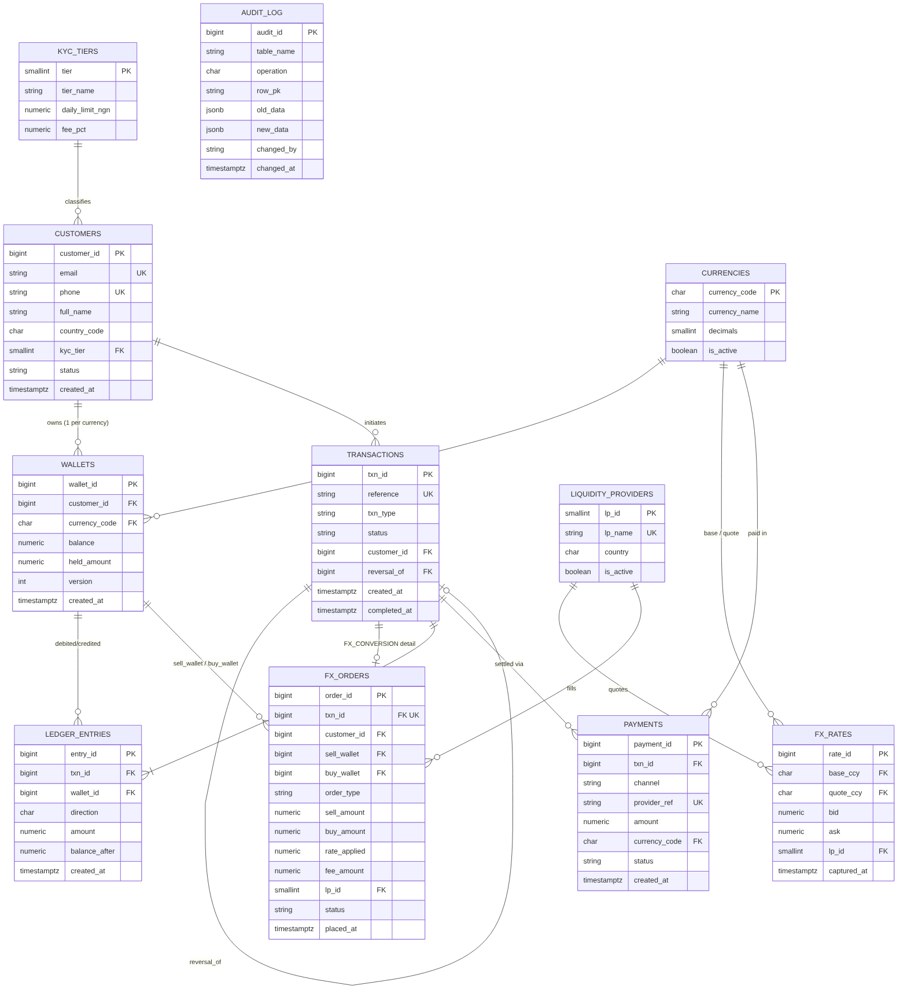

* **Keys and constraints.** Surrogate identity primary keys; natural keys for reference data (currency, KYC tier); `UNIQUE` on email, phone, `transactions.reference` (idempotency) and `(customer_id, currency_code)`; foreign keys with `ON DELETE RESTRICT` so financial history cannot be orphaned; `CHECK`s for no overdraft on customer wallets, `held <= balance`, `ask >= bid`, positive amounts.
* **Triggers.** An audit trail for KYC changes, a version bump for optimistic locking, an **append-only ledger**, and a **deferred constraint trigger** that rejects an unbalanced double-entry posting at `COMMIT`.
* **Normalisation.** `normalisation.md` walks UNF to 3NF with the real tables, and justifies three deliberate denormalisations: `balance_after`, the frozen `rate_applied`/`fee_amount` on an order, and `wallets.balance` (reconciled against the ledger).
* **Evidence.** 14 checks. Eleven are *expected* rejections (duplicate email, bad format, unknown tier, duplicate wallet, overdraft, hold > balance, ask < bid, same-currency pair, restricted delete, unbalanced ledger at commit, update of an immutable ledger); three confirm valid behaviour (balanced posting accepted, audit row written, version bumped).

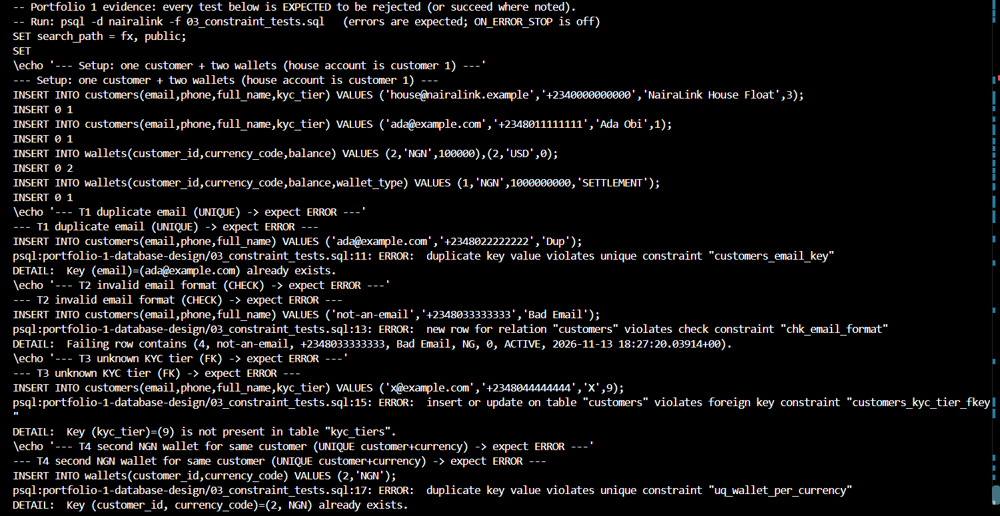

## 4. Portfolio 2: Query processing and optimisation

I ran 9 business queries with `EXPLAIN (ANALYZE, BUFFERS)` (median of 5 runs) before and after indexing, after `VACUUM ANALYZE` so the planner had fresh statistics. Plans are in `evidence/plans/`.

| Query | Before (ms) | After (ms) | What the plan showed |
|---|---:|---:|---|
| Q1a latest rate (`DISTINCT ON`) | 700.9 | 504.1 | **index barely helped**: no skip scan in PG16, all rows for the pair still read |
| Q1b latest rate (`LATERAL ... LIMIT 1`) | 579.8 | **0.10** | one index probe per liquidity provider, so the rewrite is what matters |
| Q2 wallet statement | 45.7 | **0.11** | seq scan + sort replaced by an index range scan with no Sort node |
| Q3 customer order history | 17.4 | **0.02** | index scan on `(customer_id, placed_at DESC)` |
| Q4a daily volume (live) / Q4b (materialised view) | 110.8 | 62.9 / **0.10** | covering index helps a bit; pre-aggregation removes the work |
| Q5, Q6, Q7, Q8 | 168.6, 120.2, 477.4, 95.6 | 131.2, 51.8, 417.1, 86.9 | modest; Q7 is a full-ledger audit and must scan everything |
| Q9 lookup by reference | 0.03 | 0.03 | already served by the `UNIQUE` index |

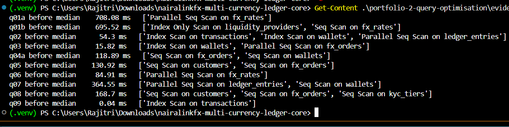
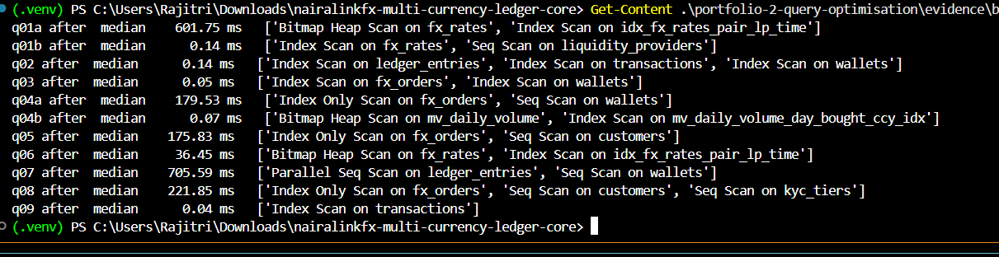

**Findings.** An index is necessary but the query shape must let the engine use it (Q1a vs Q1b); not every query gains (Q7 is O(n) by nature, the right answer is a scheduled batch); hot dashboards are best pre-aggregated, at the price of bounded staleness (`REFRESH MATERIALIZED VIEW CONCURRENTLY`). My first benchmark run showed some queries *slower* after indexing; the cause was stale statistics and an unvacuumed table, and re-running after `VACUUM ANALYZE` gave the numbers above. Details: `portfolio-2-query-optimisation/analysis.md`.

## 5. Portfolio 3: Transactions and concurrency

`fx.convert_currency()` is one atomic unit: it checks the idempotency key and KYC eligibility, reads the quote **before** taking locks, locks the four wallets in ascending id (deadlock avoidance), checks funds and limits, then posts the order, transaction and four balanced ledger legs. `scenarios.py` runs real concurrent sessions:

| Scenario | Observed |
|---|---|
| Commit / rollback | 100,000 NGN -> USD moves NGN -100,000 and USD +62.5137; an insufficient-funds attempt leaves **no trace** |
| Idempotency, reversal | retry returns the same `txn_id` and charges once; reversal posts offsetting entries, original becomes `REVERSED`, second reversal rejected |
| **Lost update** (READ COMMITTED) | naive read-modify-write ends at **900 (should be 800)**; `FOR UPDATE`, atomic `UPDATE`, or an optimistic version check give 800 |
| Non-repeatable read, phantom | seen under READ COMMITTED (1000 -> 1250; count 3 -> 4), gone under REPEATABLE READ |
| **Write skew** (daily limit) | REPEATABLE READ lets both withdrawals commit (6,000,000 > 5,000,000); **SERIALIZABLE** aborts one with `40001`, the retry is refused, total 3,000,000 |
| **Deadlock** | opposite lock order -> `40P01`; ascending-id ordering -> both commit |
| **Stress test** | 8 workers, 4,000 requests (10% duplicate retries): **414 req/s**, p50 7.6 ms, p95 93.6 ms; exactly-once check **PASS** (3,601 distinct references = 3,601 transactions) |

After all of this, four invariants hold at zero: wallets whose balance differs from the ledger sum, unbalanced transactions per currency, negative customer balances, and the net of all ledger legs.

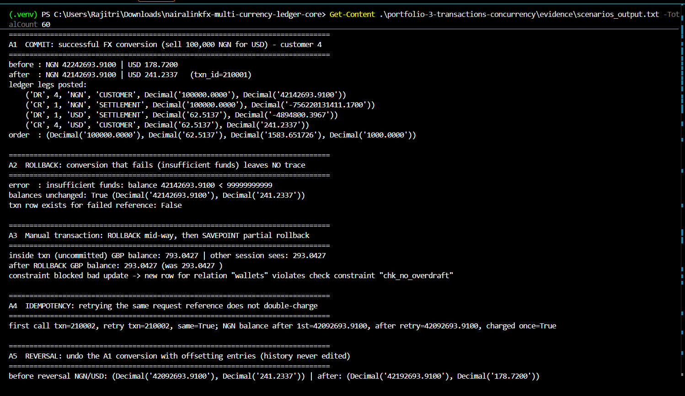

## 6. Portfolio 4: NoSQL and advanced data models

A MongoDB 7.0.48 three-node replica set holds four collections built from PostgreSQL: `customer_profiles` (20,000, **embedded** KYC documents and devices), `rate_buckets` (8,624, **bucket pattern** instead of 80,000 ticks), `trade_events` (210,000, **polymorphic** events) and `price_alerts` (30,000). Every result is cross-checked against PostgreSQL.

* A profile screen is **one document read** (1.94 ms) instead of a multi-table join.
* `$elemMatch` finds 6,232 profiles with a REJECTED/PENDING document; a brute-force check agrees. The OHLC aggregation over buckets (27.8 ms, 4,312 documents) matches PostgreSQL's raw ticks on every day; monthly volumes per currency and the `$lookup` top-5 also **MATCH**.
* **Index effect (`explain`):** trade history for one customer drops from 186.8 ms (`COLLSCAN`, 210,000 docs examined) to 2.15 ms (`IXSCAN`, 11 docs), about **87x**. The alert index is a smaller win (111.7 -> 9.8 ms) because 14% of documents match.
* **ACID across two collections:** a transaction that fails after both writes leaves nothing; the committed one changes both.
* **Suitability:** `$lookup` took 716 ms for the top-5 join, where PostgreSQL's relational joins are the better tool. So money stays in PostgreSQL and MongoDB serves flexible reads.

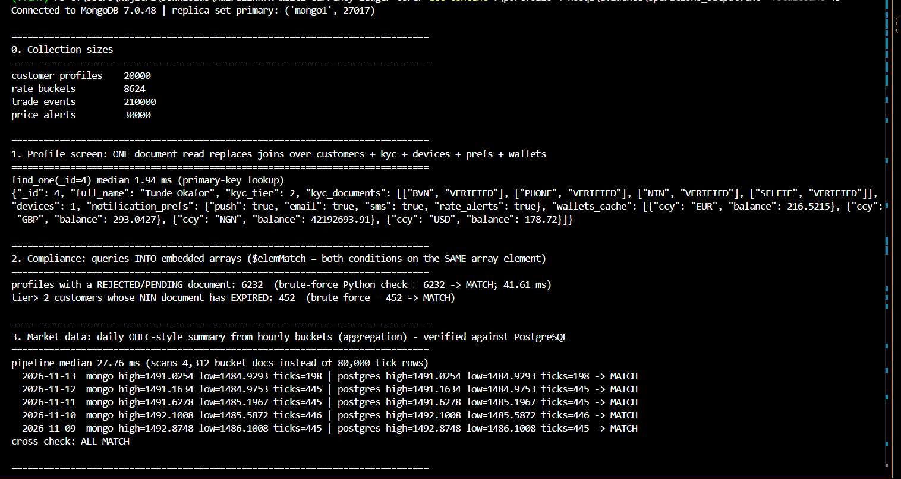

## 7. Portfolio 5: Distributed and cloud database exercise

Topology (Docker Compose): PostgreSQL primary + streaming standby, plus three MongoDB nodes.
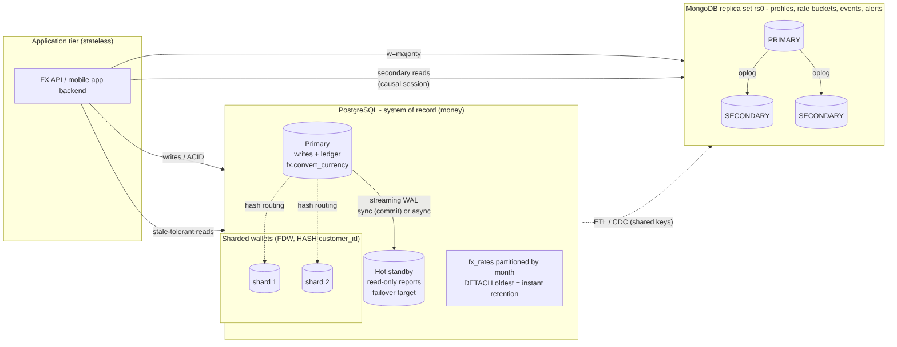

| Experiment | Result (single host, loopback) |
|---|---|
| Standby is read-only; async visibility delay | writes rejected; row visible after median **1.62 ms**, p95 3.60 ms |
| **Stale reads** on the standby (async) | **299 / 300**: eventual consistency; with `remote_apply` **0 / 300** |
| Commit latency p50 (async / sync / remote_apply) | 3.00 / 3.19 / 4.20 ms (p95 up to 23 ms for remote_apply) |
| Standby down + synchronous commit | the client's `COMMIT` **blocks**: the primary chooses consistency over availability (CP); relaxing to async restores 5.1 ms commits |
| **PostgreSQL failover** (primary killed mid-write, standby promoted) | **501 acknowledged commits, 0 lost (RPO = 0)**; first write on the new primary after **2.85 s**; WAL timeline 1 -> 2; ledger reconciliation 0 mismatches |
| **Partitioning** (`fx_rates`, 7 monthly partitions) | pruning (`Subplans Removed: 6`): 10-day query 19.7 -> 8.2 ms |
| **Sharding** (`wallets` by hash of `customer_id`, 2 databases via `postgres_fdw`) | 40,095 / 39,912 wallets; shard-key lookup contacts one shard; a non-shard-key aggregate is **not** pushed down, a shard-key aggregate **is** |
| MongoDB `w=1` vs `w=majority` secondary reads | stale reads 17 / 300 vs 0 / 300 |
| MongoDB planned step-down / `kill -9` primary | 331 and 298 acknowledged writes, **0 lost**; worst write stall 10.7 s and 11.0 s (election) |
| MongoDB loses 2 of 3 nodes | writes refused (`NotPrimaryError`), reads still served: **CP** behaviour |

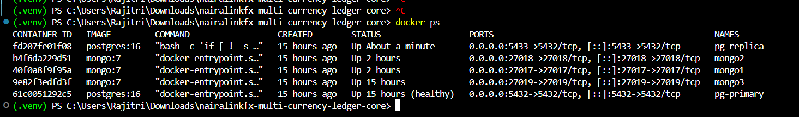
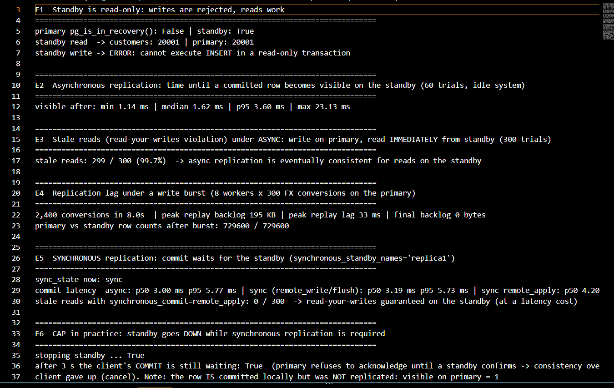
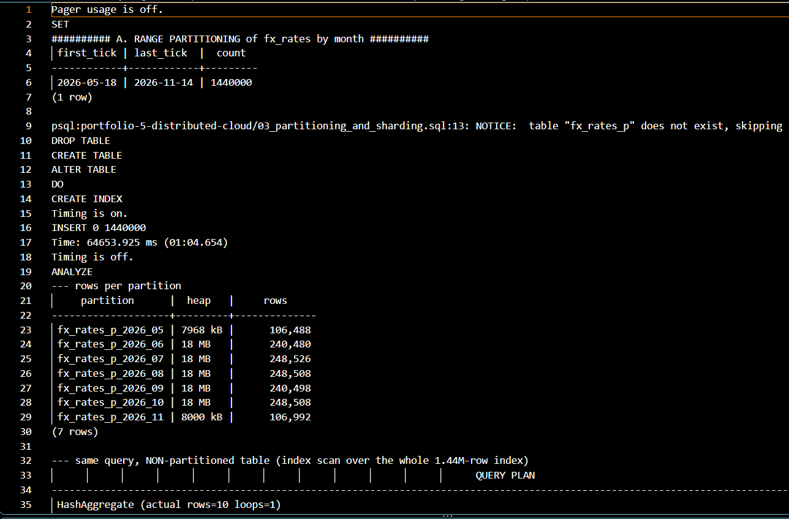
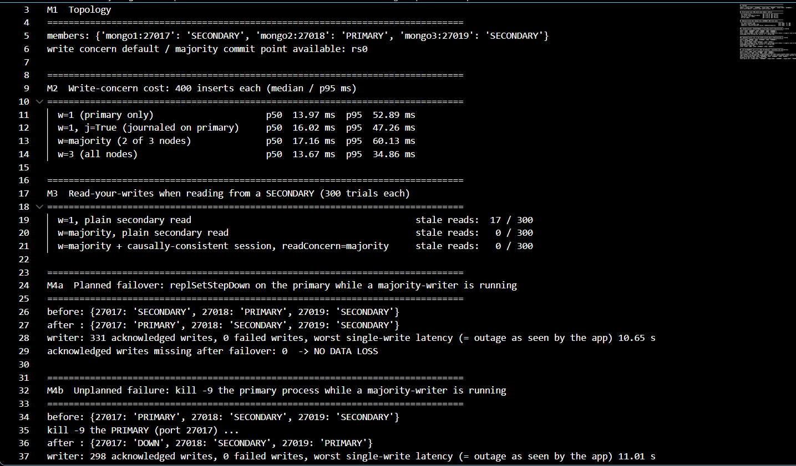

**CAP/PACELC position:** the ledger uses synchronous/majority replication (consistency over availability, paying latency); dashboards and profile reads may use async replicas or secondaries. **Cloud mapping (design only, not deployed):** PostgreSQL -> managed Multi-AZ service (RDS/Aurora, Cloud SQL), MongoDB -> Atlas replica set, sharding -> Citus/Atlas sharded cluster, backups -> point-in-time restore. **Limits:** one host with loopback networking understates real latency; `postgres_fdw` has no two-phase commit, so a production design keeps a customer's wallets and a settlement wallet on one shard.

## 8. Individual technical reflection

I used a double entry ledger so that we can verify it was correct. Each time an experiment was run the wallets should equal the ledger. The thing I learnt the most from was the following points: (1) The first time I ran the latest rate query my index had no effect. Looking at the plan I saw that this was because there is no skip scan in PostgreSQL 16. This was only resolved by using the `LATERAL` rewrite. (2) My first benchmark showed that many queries were slower after adding indexes. This was because the statics were out of date. I fixed this by running the benchmark again after running `VACUUM ANALYZE`. This also taught me to make sure the measurements are clean. (3) When running In Docker the standby failed to start. This was because the primary was reporting healthy while the temporary startup server was just using the sockets. I fixed this by changing the healthcheck to use TCP. I also gave the containers static names. (4) When trying to reproduce the write skew I saw that using REPEATABLE READ is not enough to implement a cross row business rule. I also saw that SERIALIZABLE requires a retry loop. To improve my design I would split the hot house wallet into individual wallets for each shard and run the tests on a real cloud network.

## 9. AI use declaration

* **Tool:** Claude.
* **Used for:** drafting the first versions of the SQL and Python scripts as well as debugging errors from Powershell and Docker.
* **How I verified it:** Asides reconfiming methods from official documentaion, I ran every script manually against PostgreSQL 16 and MongoDB 7 in Docker and committed the outputs from the runs; I cross-checked every MongoDB aggregate against PostgreSQL (all MATCH); I re-ran the benchmarks when results looked wrong; and I debugged the failures that occurred (replica start-up race, container names, output encoding).

## 10. References
PostgreSQL 16 Documentation; MongoDB Manual 7.0; psycopg 3 and PyMongo documentation; Docker images `postgres:16` and `mongo:7`; Kleppmann, M. (2017) *Designing Data-Intensive Applications*; Gilbert, S. and Lynch, N. (2002) "Brewer's conjecture and the feasibility of consistent, available, partition-tolerant web services"; Abadi, D. (2012) "Consistency tradeoffs in modern distributed database system design" (PACELC); Berenson, H. et al. (1995) "A critique of ANSI SQL isolation levels"; Cahill, M., Röhm, U. and Fekete, A. (2008) "Serializable isolation for snapshot databases". Data is synthetic and generated by `01_seed_data.sql`.
