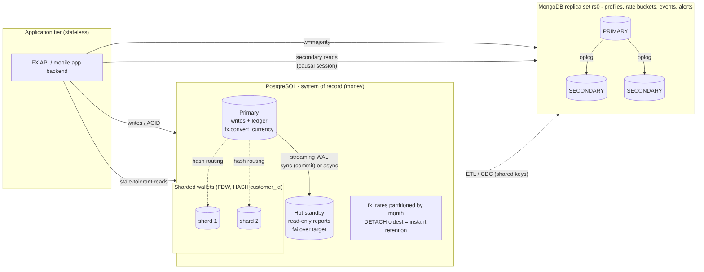

# Portfolio 5 - Distributed and Cloud Database Exercise (6 marks)

Same NairaLink FX case study. **Everything below was run for real** (PostgreSQL 16 primary + streaming standby + 2 shard databases;
MongoDB 7.0.34 3-node replica set) - outputs in `evidence/`. Topology: `architecture.png`.

| File | What it does | Evidence |
|---|---|---|
| `01_pg_streaming_replication.sh` | `pg_basebackup -R` + replication slot -> hot standby on port 5433 | `evidence/01_replication_setup_output.txt` |
| `02_replication_experiments.py` | Read-only standby, lag, stale reads, sync vs async commit cost, standby-down behaviour | `evidence/02_replication_experiments_output.txt` |
| `03_partitioning_and_sharding.sql` | Range partitioning of `fx_rates`; hash-sharding of `wallets` across 2 databases (postgres_fdw) | `evidence/03_partitioning_sharding_output.txt` |
| `04_mongo_replica_set_experiments.py` | Write concern, read-your-writes, planned/unplanned failover, loss of majority | `evidence/04_mongo_replica_set_output.txt` |
| `05_pg_failover.py` | Kill primary mid-write, promote standby, verify zero acknowledged-commit loss | `evidence/05_pg_failover_output.txt` |
| `docker-compose.yml` | The same topology for your own machine (**not run by me**, see note inside) | - |

## 1. Replication (PostgreSQL)
| Experiment | Measured result |
|---|---|
| Standby is read-only | `cannot execute INSERT in a read-only transaction` |
| Async: row visible on standby after | median **0.50 ms**, p95 0.93 ms (loopback; real networks add RTT) |
| Async: read immediately after write on the standby | **297 / 300 stale** (99%) - eventual consistency for replica reads |
| 8-worker write burst (2,400 conversions) | peak backlog 46 KB, peak replay lag 3 ms, caught up to 0 bytes; counts equal (758,324 / 758,324) |
| Commit latency p50: async / sync / sync+remote_apply | 0.42 / 1.01 / 0.80 ms (loopback; the sync cost is a network round trip in production) |
| Stale reads with `synchronous_commit=remote_apply` | **0 / 300** |
| Standby down + synchronous replication required | client COMMIT **blocks** (still waiting after 3 s); relaxing to async restores 2.4 ms commits |

**Lesson (CAP):** with synchronous replication the primary chooses **consistency over availability** - it will not acknowledge a commit that
only one node holds. Relaxing to async chooses **availability** and accepts losing the most recent commits if the primary dies.
Note the subtle case in E6: cancelling the blocked commit leaves the row committed locally but *unreplicated* - apps must treat a
cancelled/timeout commit as "unknown" and retry idempotently (our `reference` idempotency key does exactly this).

## 2. Failover (PostgreSQL) - `05_pg_failover.py`
Synchronous replication on; writer inserting continuously; primary killed with `stop -m immediate` (power-cut simulation); standby promoted.
* **1,159 acknowledged commits -> 0 lost (RPO = 0).** 1,160 rows existed on the standby: one commit had reached the standby but the primary died before acknowledging it - durable but unacknowledged (the client must not assume failure).
* First successful write on the new primary **0.43 s** after the failure (manual `pg_ctl promote`; automatic tools such as Patroni/RDS add failure-detection time, typically 10-60 s).
* WAL timeline 1 -> 2: the promoted node starts a new history; the old primary must be rewound (`pg_rewind`) or rebuilt before rejoining. Ledger reconciliation = 0 mismatches and FX conversions work on the new primary.

## 3. Partitioning (single node) - `03_..._sharding.sql` part A
* `fx_rates` (1.44M rows) split into 7 monthly partitions; the 10-day query shows `Subplans Removed: 6` (**partition pruning**).
* Honest result: that query was already fast with the Portfolio-2 index (2.14 ms plain vs 2.20 ms partitioned) - pruning is not a magic speed-up when a good index exists.
* Real benefit - **retention**: deleting one month = `DELETE` of 240,498 rows **372 ms** (plus bloat/vacuum) vs `DETACH PARTITION` **11.7 ms**, metadata only.

## 4. Sharding (horizontal scale-out) - part B
`wallets` is `HASH(customer_id)` partitioned across two PostgreSQL databases via `postgres_fdw` (shard key = customer, because almost every operation
touches one customer's wallets).
* Distribution: **40,095 / 39,912** wallets (10,023 / 9,978 customers) - even.
* Query **with** shard key -> `EXPLAIN` shows a single Foreign Scan (one shard contacted). Query **without** it (`wallet_id`) -> Append over **both** shards (scatter-gather).
* Aggregate `GROUP BY currency` is **not** pushed down by PostgreSQL 16 (raw rows cross the network); `GROUP BY customer_id` (the shard key) **is** pushed down (`Remote SQL: ... sum(balance) ... GROUP BY 1`).
* Correctness: sharded totals equal the original to 4 decimals for every currency.
* **Known limitation (design discussion):** a conversion touching customer wallets on one shard and the house wallet elsewhere would span nodes; `postgres_fdw` has no two-phase commit,
  so a production design keeps each customer's wallets *and* a per-shard settlement wallet on the same shard (this also removes the hot house-wallet row found in Portfolio 3), or uses 2PC/saga.

## 5. MongoDB replica set - `04_...py`
| Experiment | Measured result |
|---|---|
| Write concern p50: `w=1` / `w=1,j` / `w=majority` / `w=3` | 0.75 / 2.52 / 3.45 / 3.33 ms - durability costs latency |
| Read from a secondary right after write: `w=1` | **251 / 300 stale** |
| ... `w=majority`, plain secondary read | 17 / 300 stale |
| ... `w=majority` + causally-consistent session + `readConcern=majority` | **0 / 300** stale |
| Planned `replSetStepDown` under write load | new primary elected, 676 acked writes, **0 lost**, worst write stalled **10.3 s** |
| `kill -9` of the primary under write load | 1,071 acked writes, **0 lost**, worst stall **10.7 s**; killed node rejoined as SECONDARY |
| Kill 2 of 3 nodes | surviving node became SECONDARY: **writes refused** (`NotPrimaryError`), reads still served (stale-tolerant); after restart cluster recovered, 4,247/4,247 documents intact |

The ~10 s stall is the election timeout (`electionTimeoutMillis` default 10 s) plus driver server selection. Retryable writes + `w=majority` made it
invisible as errors: the app just waited, and nothing acknowledged was lost.

## 6. CAP / PACELC position of this design
| Component | During a partition / failure (CAP) | Normal operation (PACELC: latency vs consistency) |
|---|---|---|
| PostgreSQL primary + **sync** standby | **CP**: stops acknowledging commits rather than risk divergence | pays ~1 round trip per commit for consistency |
| PostgreSQL primary + async standby | **AP-ish**: stays writable, may lose last ms of commits | low latency, replica reads are stale |
| MongoDB `w=majority` | **CP**: minority side refuses writes | pays 2-node ack (3.45 ms vs 0.75 ms) |
| MongoDB secondary reads | serves reads from minority (stale allowed) | latency win, consistency lost unless causal session |
Money (ledger) therefore uses **sync/majority**; dashboards, rates and profile reads may use **replicas/secondaries**.

## 7. Cloud deployment mapping (design - not deployed by me)
| Need | Self-managed (what I ran) | Managed cloud equivalent |
|---|---|---|
| PostgreSQL HA | primary + sync standby | Amazon RDS/Aurora Multi-AZ, Google Cloud SQL HA, Azure Flexible Server zone-redundant |
| Read scaling | hot standby | managed read replicas |
| Mongo replica set | 3 `mongod` | MongoDB Atlas (M10+ 3-node replica set, multi-region) |
| Sharding | FDW hash shards | Citus / Aurora Limitless; Atlas sharded cluster (`shardCollection` on hashed `customer_id`) |
| Backups / PITR | WAL archive | automated backups + point-in-time restore |
| Locality | single node | region close to users (e.g. AWS af-south-1 Cape Town / Lagos edge), plus a cross-region replica for DR |
If you do deploy a free tier (Neon/Supabase for PostgreSQL, Atlas M0 for MongoDB), add your own screenshots to `evidence/` and mention it in the final document; see `../SETUP.md`, section "Optional cloud deployment".
