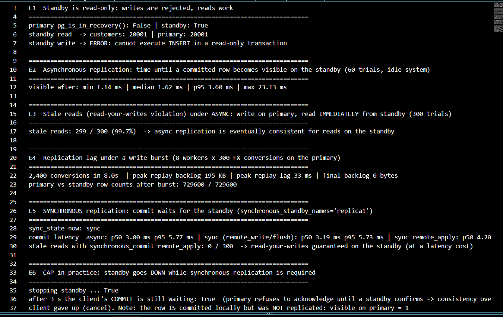
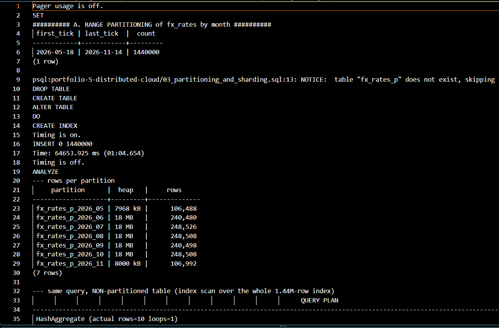
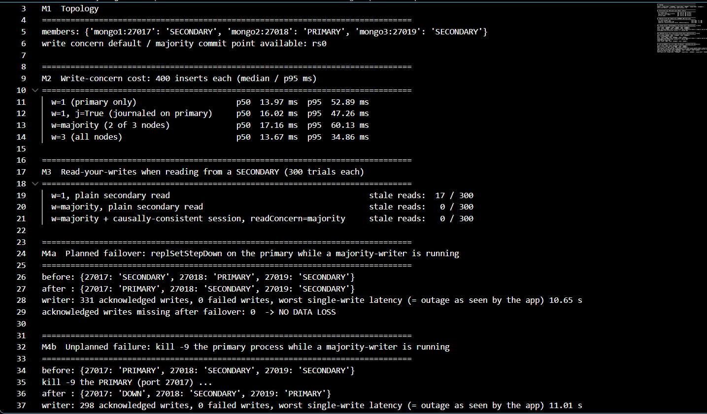
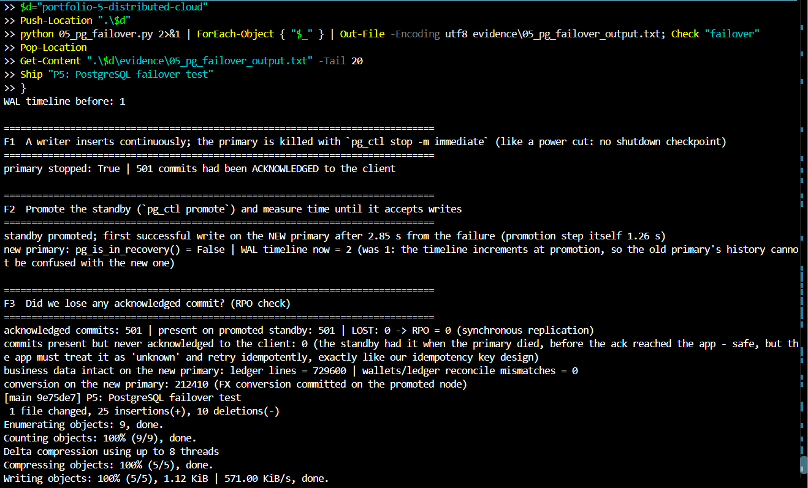

# Portfolio 5 - Distributed and Cloud Database Exercise

Same NairaLink FX case study. Everything below was run on my machine with Docker (PostgreSQL 16 primary + streaming standby + two shard databases; MongoDB 7.0.48 three-node replica set). Raw outputs are in `evidence/`. Topology:


| File | What it does | Evidence |
|---|---|---|
| `docker-compose.yml` + `docker/pg-init/` | The topology: `pg-primary` (5432), `pg-replica` (5433, `application_name=replica1`), `mongo1/2/3` (27017-27019) | `screenshots/P5_docker_ps.png` |
| `02_replication_experiments.py` | Read-only standby, lag, stale reads, sync vs async commit cost, standby-down behaviour | `evidence/02_replication_experiments_output.txt` |
| `03_partitioning_and_sharding.sql` | Range partitioning of `fx_rates`; hash-sharding of `wallets` across two databases (`postgres_fdw`) | `evidence/03_partitioning_sharding_output.txt` |
| `04_mongo_replica_set_experiments.py` | Write concern, read-your-writes, planned and unplanned failover, loss of majority | `evidence/04_mongo_replica_set_output.txt` |
| `05_pg_failover.py` | Kill the primary mid-write, promote the standby, verify no acknowledged commit was lost | `evidence/05_pg_failover_output.txt` |

## Run it (PowerShell, from the repository root, Docker Desktop running)
```powershell
. .\env.ps1                                           # sets MODE=docker so the scripts control the containers
docker compose -f .\portfolio-5-distributed-cloud\docker-compose.yml up -d
docker ps                                             # pg-primary, pg-replica, mongo1-3 should be Up
# rebuild the FX database on the compose primary (Portfolios 1-3 scripts), then:
cd .\portfolio-5-distributed-cloud
python 02_replication_experiments.py
psql -d nairalink -f .\03_partitioning_and_sharding.sql
python 04_mongo_replica_set_experiments.py
python 05_pg_failover.py                              # destroys the primary on purpose: run it last
```
Mongo hostnames need `127.0.0.1 mongo1 mongo2 mongo3` in the Windows hosts file.

## 1. Replication (PostgreSQL)
| Experiment | Measured result |
|---|---|
| Standby is read-only | `cannot execute INSERT in a read-only transaction`; reads work |
| Async: time until a committed row is visible on the standby | median **1.62 ms**, p95 3.60 ms (loopback; real networks add round-trip time) |
| Async: read immediately after a write on the standby | **299 / 300 stale** (99.7%): eventual consistency for replica reads |
| 8-worker write burst (2,400 conversions in 8.0 s) | peak backlog 195 KB, peak replay lag 33 ms, caught up to 0 bytes; row counts equal (729,600 / 729,600) |
| Commit latency p50: async / sync / sync+`remote_apply` | 3.00 / 3.19 / 4.20 ms (p95 for `remote_apply` 23.05 ms) |
| Stale reads with `synchronous_commit = remote_apply` | **0 / 300** |
| Standby down while synchronous replication is required | the client `COMMIT` **blocks** (still waiting after 3 s); relaxing to async restores a 5.1 ms commit |



**Lesson (CAP):** With synchronous replication, **consistency is prioritized over availability** by making the primary node ignore commits that only exist on a single node. By switching to async replication, **availability is prioritized**, and we accept loss of most recent commits if the primary node fails. Because the commit was cancelled, it is committed locally but not replicated. As such, any application must mark these timed out commits as unknown and retry them idempotently (`reference` uses an idempotent key for this).

## 2. Failover (PostgreSQL), `05_pg_failover.py`
Synchronous replication on; a writer inserting continuously; the primary killed abruptly (power-cut simulation); the standby promoted.
* **501 acknowledged commits, 0 lost (RPO = 0)**; 501 present on the promoted standby.
* First successful write on the new primary **2.85 s** after the failure (promotion step itself 1.26 s); this is a manual `pg_ctl promote`, and automatic tools such as Patroni or a managed service add failure-detection time.
* WAL timeline 1 -> 2: the promoted node starts a new history, so the old primary must be rewound (`pg_rewind`) or rebuilt before it rejoins.
* The ledger still reconciles (729,600 lines, 0 wallet/ledger mismatches) and an FX conversion commits on the new primary.

## 3. Partitioning (single node), part A of `03_..._sharding.sql`
* `fx_rates` (1.44M rows) is split into 7 monthly range partitions; the 10-day query shows `Subplans Removed: 6` (**partition pruning**) and runs in 8.2 ms against 19.7 ms on the plain table.
* Real benefit for retention: dropping a month is a metadata `DETACH PARTITION` instead of a large `DELETE`.

## 4. Sharding (horizontal scale-out), part B
`wallets` is `HASH(customer_id)` partitioned across two PostgreSQL databases via `postgres_fdw` (the shard key is the customer because almost every operation touches one customer's wallets).
* Distribution: **40,095 / 39,912** wallets (10,023 / 9,978 customers), an even split.
* A query **with** the shard key shows a single Foreign Scan (one shard contacted); one **without** it (by `wallet_id`) is an Append over **both** shards (scatter-gather).
* An aggregate `GROUP BY currency` is **not** pushed down by PostgreSQL 16 (raw rows cross the network); `GROUP BY customer_id` (the shard key) **is** pushed down.
* Sharded totals equal the original totals for every currency.
* **Known limitation:** a conversion touching customer wallets on one shard and the house wallet on another would span nodes; `postgres_fdw` has no two-phase commit. A production design keeps each customer's wallets and a per-shard settlement wallet together (this also removes the hot house-wallet row from Portfolio 3), or uses 2PC or sagas.



## 5. MongoDB replica set, `04_...py`
| Experiment | Measured result |
|---|---|
| Write concern p50: `w=1` / `w=1,j` / `w=majority` / `w=3` | 13.97 / 16.02 / 17.16 / 13.67 ms: differences are within noise on one host, so I draw no conclusion about their cost |
| Secondary read right after a write: `w=1` | **17 / 300 stale** |
| ... `w=majority`, plain secondary read | **0 / 300** |
| ... `w=majority` + causally consistent session + `readConcern=majority` | **0 / 300** |
| Planned `replSetStepDown` under write load | new primary elected; 331 acknowledged writes, **0 lost**; worst single write stalled **10.65 s** |
| `kill -9` of the primary under write load | 298 acknowledged writes, **0 lost**; worst stall **11.01 s** |
| Lose 2 of 3 nodes | surviving node stayed a secondary: writes refused (`NotPrimaryError`), reads from it still served (possibly stale); the cluster recovered after both nodes restarted (3,129 documents) |

The roughly 10 s stall is the election timeout (default `electionTimeoutMillis` 10 s) plus driver server selection; retryable writes with `w=majority` made it appear as a wait rather than an error.



## 6. CAP / PACELC position of this design
| Component | During a partition or failure (CAP) | Normal operation (PACELC: latency vs consistency) |
|---|---|---|
| PostgreSQL primary + **sync** standby | **CP**: stops acknowledging commits rather than diverge | pays about one round trip per commit |
| PostgreSQL primary + async standby | **AP-leaning**: stays writable, may lose the last commits | low latency, replica reads are stale |
| MongoDB `w=majority` | **CP**: the minority side refuses writes | waits for a second node's acknowledgement |
| MongoDB secondary reads | serve reads from a minority (stale allowed) | latency win; consistency lost unless a causal session is used |

Money (the ledger) therefore uses **sync / majority**; dashboards, rates and profile reads may use **replicas / secondaries**.

## 7. Cloud deployment mapping (design only, not deployed by me)
| Need | Self-managed (what I ran) | Managed cloud equivalent |
|---|---|---|
| PostgreSQL HA | primary + sync standby | Amazon RDS/Aurora Multi-AZ, Google Cloud SQL HA, Azure Flexible Server zone-redundant |
| Read scaling | hot standby | managed read replicas |
| MongoDB replica set | 3 `mongod` containers | MongoDB Atlas 3-node replica set, multi-region |
| Sharding | FDW hash shards | Citus / Aurora Limitless; Atlas sharded cluster (`shardCollection` on hashed `customer_id`) |
| Backups / PITR | none in this lab | automated backups and point-in-time restore |
| Locality | single host | a region close to users plus a cross-region replica for disaster recovery |

## Limitations
All experiments ran on one host with loopback networking, so absolute latencies understate production values; the behaviours (stale reads, blocking commits, elections, zero acknowledged loss) are what the evidence shows.


